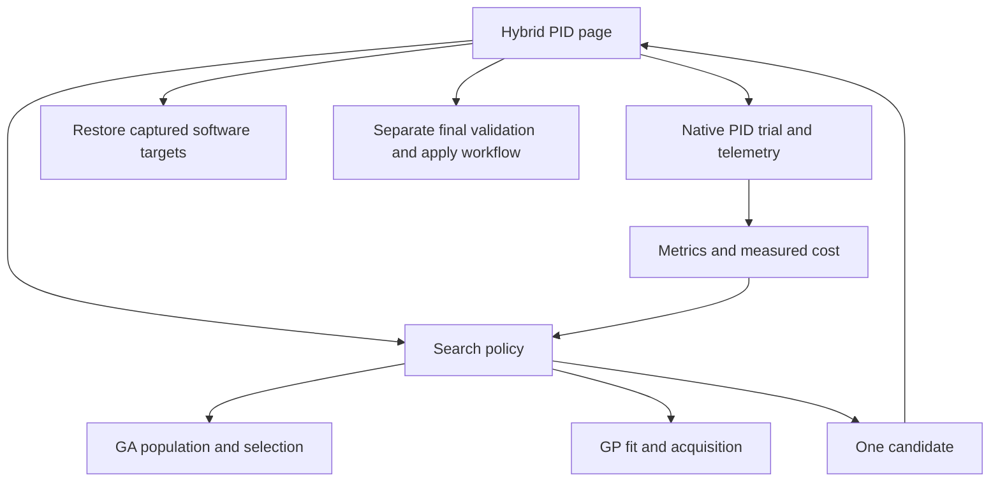

# Architecture and shared search machinery

## Ownership and source map

All paths below are relative links to the implementation.

| Component | Responsibility |
| --- | --- |
| [HybridPIDPage.py](../../python/app/Automation/HybridPIDPage.py) | Settings, session capture, telemetry checks, trial sequencing, target restoration, validation, export |
| [hybrid_pid_optimizer.py](../../source/Python/Optimization/hybrid_pid_optimizer.py) | `HybridConfig`, `HybridState`, original sequential handover policy, reference drift checks |
| [rolling_hybrid_optimizer.py](../../source/Python/Optimization/rolling_hybrid_optimizer.py) | Factory, rolling training window, local refinement, inheritance decisions |
| [genetic_optimizer.py](../../source/Python/Optimization/genetic_optimizer.py) | Hybrid-facing bounded GA API and history |
| [october_ga.py](../../source/Python/Optimization/october_ga.py) | Tournament selection, blend crossover, Gaussian mutation, elitism |
| [pid_gain_adapter.py](../../source/Python/Optimization/pid_gain_adapter.py) | Gain/result data classes and mapping to generic BO observations |
| [bayesian_optimizer.py](../../source/Python/Optimization/bayesian_optimizer.py) | Generic BO data store, tensors, proposals and model visualization |
| [training.py](../../source/Python/Optimization/training.py) | Physical gain vectors and negative-cost training targets |
| [surrogate_model.py](../../source/Python/Optimization/surrogate_model.py) | GP fit and posterior mean/variance |
| [acquisition.py](../../source/Python/Optimization/acquisition.py) | qLogExpectedImprovement proposal optimization |
| [trial_metrics.py](../../source/Python/Optimization/trial_metrics.py) | Response diagnostics and scalar objective adapter |
| [ga_evaluation.py](../../source/Python/Automation/ga_evaluation.py) | Five-term October fitness calculation |
| [ga_recovery.py](../../source/Python/Automation/ga_recovery.py) | Pure captured-target reset requests |

## Initial population

Initialization validates the seed against the bounds and constructs:

- Index 0: the supplied seed gains.
- Index 1: seed plus independent uniform perturbations of up to 5% of each full
  gain span, clipped to the configured bounds.
- Remaining `population - 2` individuals: independently shuffled stratified
  samples along each gain axis. This broadens early GP data beyond a local cluster.

The initial random population created by `GAPIDTuner.initialize()` is subsequently
overwritten in these positions. Reproducing the exact initialization therefore
requires preserving the actual RNG call sequence, not just the sampling formula.

## Evolution

Each measured GA fitness advances the population index. At a completed generation,
the wrapper delegates reproduction to the October GA engine using the same RNG.
That engine ranks candidates with validity awareness, keeps elites, selects parents
by tournament, samples blend crossover children, applies Gaussian mutation, and
clips gains to bounds. Children and elites are evaluated again in the next
generation. Hybrid defaults override the mutation settings described by the
standalone October engine.

## BO model

The hybrid uses CPU execution (`use_cuda=False`). Training inputs have three
columns, one for each actual gain. Targets are `-cost`, because BoTorch maximizes.
`SingleTaskGP` normalizes inputs using the full gain bounds and standardizes the
single output. It fits an exact marginal log likelihood. The acquisition is
qLogExpectedImprovement; each hybrid call requests one point.

Posterior output mean is negated back to cost units. Posterior standard deviation
is `sqrt(max(variance, 0))`. Repeated measurements remain separate GP rows. The
baseline-noise decision thresholds are separate from the GP likelihood's learned
noise; they are not explicitly passed as per-observation noise variances.

## Sequential contract

`propose_batch(1)` returns a one-element list and sets `pending` and
`pending_source`. Another proposal is rejected until one matching result is
recorded. `record_results([result])` checks exact candidate equality and delegates
finite-value, controller-kind and parameter-space validation to the adapter and
generic observation layer. A batch size other than one is rejected.

RNG streams use `seed` for GA, `seed + 1` for confirmation ordering, `seed + 2`
for exploration, and `seed + 3` for windowed learning choices. Acquisition uses
`seed + number_of_recorded_results`. Seeded policy reproducibility does not imply
identical physical measurements or identical numerical fits across environments.
