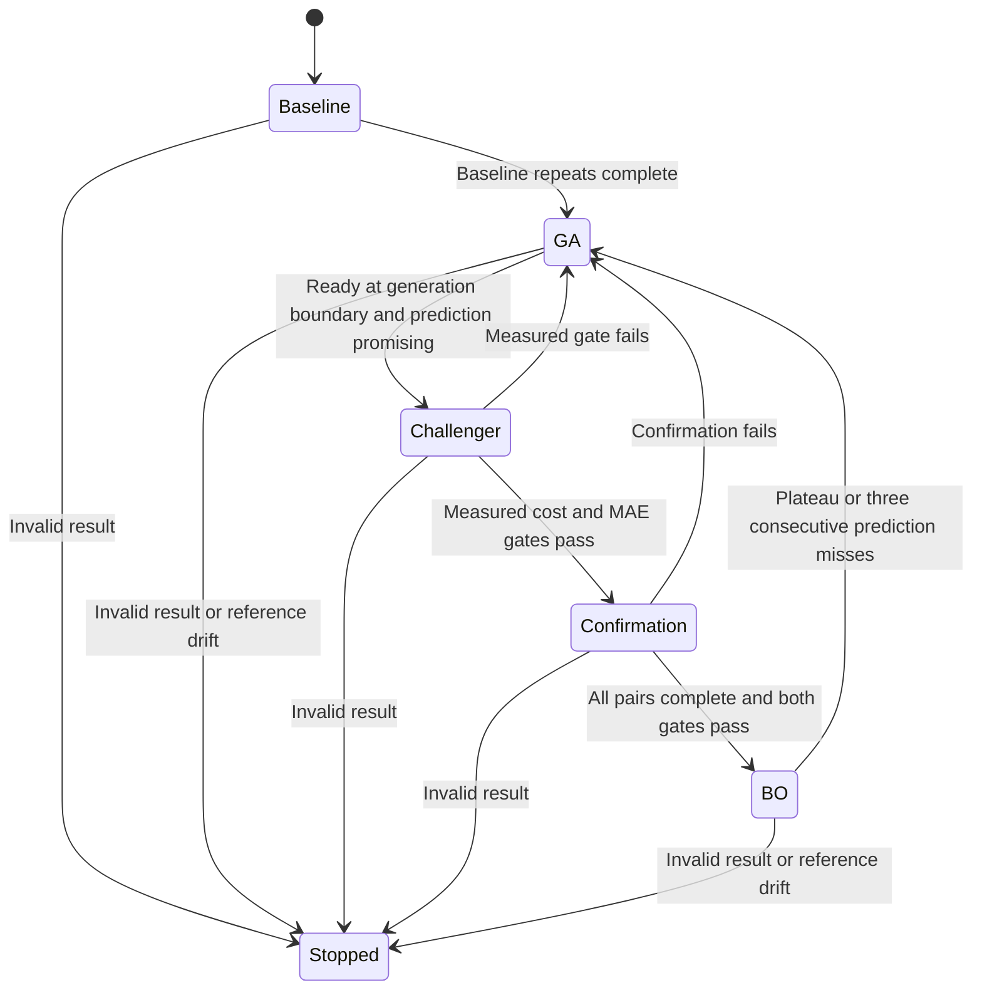

# Original complete-history handover

Implementation: [HybridPIDOptimizer](../../source/Python/Optimization/hybrid_pid_optimizer.py).

## States

Actual enum values are `Baseline`, `GA`, `BO challenger`, `Confirmation`, `BO`,
and `Stopped`. Reference and exploration are trial sources, not extra states.
Recovery and final validation belong to the page workflow.

## Proposal scheduling

The ordered scheduler first rejects stopped/exhausted sessions, then chooses:

1. Outstanding initial baseline repeats at the seed gains.
2. Queued confirmation repeats.
3. A due or already-started reference batch, provided a new full batch fits.
4. A due space-filling exploration trial.
5. The normal GA or BO proposal.

Baseline and reference observations do not advance the reference/exploration
counters. All other trial sources increment both counters; an exploration result
resets its own counter. Completing a reference batch resets the reference counter.
Consequently the intervals are counts of qualifying trials, not wall-clock times.
Confirmation cannot be interrupted by a reference or exploration check.

Exploration samples 64 uniform points in normalized three-dimensional gain space
and chooses the point whose nearest observed location is farthest away in squared
Euclidean distance. Scores do not participate. Exploration trains BO without
consuming a GA population slot.

## Readiness and challenger

BO readiness requires both the configured number of distinct valid gain vectors
and minimum normalized span along **every** gain axis. Repeated seed measurements
count as multiple observations but one distinct vector. The span applies to the
whole collection, not to a single candidate. Complete-history readiness cannot
shrink merely because another valid observation arrives with fixed bounds.

During GA, a model attempt occurs only at a generation boundary (`ga.index == 0`)
and at most once per GA generation. Predictions must be finite, uncertainty
nonnegative, and gains in bounds. A promising prediction clears the conservative
cost gate in [the equations reference](04_Metrics_and_Equations.md). It stores the
incumbent and challenger and requests a physical `BO challenger` trial.

The measured challenger must improve both cost and beam MAE beyond their separate
relative/noise thresholds and pass `eligible()`. A valid but unconvincing result
returns to GA and remains in training history. An invalid trial stops the session.

## Paired confirmation

Successful screening queues `confirmation_pairs` incumbent/challenger pairs.
Pair orientation alternates from a seeded random start, then orientations are
shuffled. With an odd number of pairs the two orientations differ in count by
one. Each pair still contains one measurement of each candidate.

Only after the full queue finishes does the code compare paired cost differences
and paired MAE differences with their respective relative, noise and Student-t
margins. All challenger repeats must be eligible. Passing both metric gates
enters BO and resets its stall and prediction-miss counters. Failure returns to
GA. Budget exhaustion partway through confirmation cannot promote the challenger.

## BO and fallback

Once BO owns search, it proposes even when the earlier promising-prediction gate
would fail; the gate is used to screen the initial challenger. Reference and
exploration scheduling still apply. Each ordinary BO result updates:

- Cost-stall count: reset by meaningful measured improvement over the previous
  best candidate's mean cost; otherwise increment.
- Prediction-miss count: increment when absolute measured/predicted disagreement
  exceeds the heuristic margin; otherwise reset. Unexpectedly good results can
  count as misses too.

At `plateau_trials` consecutive stalls or three consecutive misses, return to GA
and put the best measured gains in population slot zero. The GA generation marker
prevents an immediate new handover attempt in that same generation. Reference
and exploration results do not update either BO counter.

## Best result and stops

Candidate ranking uses mean cost across valid repeats, excluding rejected
validation candidates and observations without metrics. The returned result is
the actual repeat closest to that candidate's mean; its individual `score` may
differ from the ranking mean. Drift makes `best_result` return `None`.

An invalid response records its audit entry, clears queued comparisons, and
enters `Stopped`. A stopped optimizer rejects proposals. Budget exhaustion also
rejects proposals but does not change the last enum state. Starting again requires
the surrounding application to create a new session.
